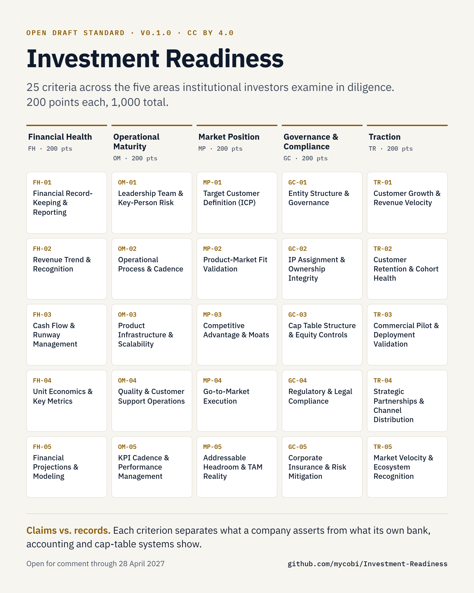

# Investment Readiness: IRD and IRS

**Investment Readiness** is an open draft vocabulary for what institutional investors examine in diligence: 5 dimensions, 25 criteria, CC BY 4.0.

**Why it's different:** it separates what a company *claims* from what its own systems *record*. Most readiness evidence is authored by the company being assessed; bank, accounting and cap-table history is not.

**We want your critique** through 28 April 2027: what's missing, what overlaps, what's wrong. [Start in Discussions →](https://github.com/mycobi/Investment-Readiness/discussions)

MYCOBI builds a commercial scoring implementation on this. The criteria are open; our weights are not. [Details below](#scope-and-rights).

<picture>
  <source media="(prefers-color-scheme: dark)" srcset="docs/images/criteria-grid-dark.png">
  <source media="(prefers-color-scheme: light)" srcset="docs/images/criteria-grid-light.png">
  
</picture>

See the criteria applied in a [hypothetical worked example](templates/illustrative-walkthrough.md).

**Status:** Draft open for a six-month public review.
**Specification version:** 0.1.0-draft
**Steward:** MYCOBI, Inc.
**RFC window:** 28 October 2026 to 28 April 2027.
**Draft freeze:** 28 February 2027, as scheduled in [ROADMAP.md](ROADMAP.md).

The Investment Readiness Diagnostic (IRD) assesses preparation for institutional diligence. The Investment Readiness Score (IRS) summarizes the diagnostic's findings. This repository publishes the dimensions, 25 public criteria, 200-point dimension architecture, evidence categories and interpretation principles for comment.

The specification does not disclose response rubrics, detailed scoring weights, calibration, verification rules or algorithms. It is not sufficient to reproduce a MYCOBI IRS. A shared vocabulary does not establish interchangeable scores across independently developed implementations.

## Start here

- [Overview](docs/00-overview.md) and [glossary](docs/03-glossary.md)
- [Methodology](docs/01-methodology.md) and [25 criteria](docs/02-criteria-index.md)
- [Public scope and evidence](docs/04-public-scope-and-evidence.md)
- [Assessment review workflow](docs/05-assessment-review-workflow.md)
- [Field-testing templates](templates/README.md), including the [illustrative walkthrough](templates/illustrative-walkthrough.md)
- [Review roadmap](ROADMAP.md), [open decisions](OPEN-DECISIONS.md), and [comment dispositions](DISPOSITION-OF-COMMENTS.md)
- [Complete inventory](CONTENTS.md)

## Participate

Questions and criticism are welcome through issue forms without signing a CLA. [Discussions](https://github.com/mycobi/Investment-Readiness/discussions) is enabled for broad conceptual feedback. People outside MYCOBI propose document changes from a fork. Only MYCOBI maintainers merge. Substantive submissions receive acknowledgment within five business days during the review window. Original material proposed for incorporation follows [CONTRIBUTING.md](CONTRIBUTING.md). Company-owned contributions require separate authority checks.

The paper is a separate publication and is not stored here. Feedback on the methodology belongs here; paper feedback belongs with its publication.

## Contact

For matters that should not be posted publicly, email support@mycobi.com. This includes vulnerability reports, conduct reports, requests to remove confidential material posted by mistake, paperwork for company-owned contributions and trademark permission requests. See [SECURITY.md](SECURITY.md). Do not put sensitive detail in public issues, pull requests, or discussions. Feedback on the standard itself belongs in the issue forms or Discussions.

## Scope and rights

MYCOBI, Inc. stewards this specification and also builds and sells commercial implementations of the assessment; the calibrated weights, response rubrics and scoring algorithms are proprietary and are not published here.

The public architecture consists of five dimensions and five criteria per dimension, with a maximum of 200 points per dimension and 1,000 overall. The IRS does not include technology maturity or business maturity as components.

Public specification text is licensed under [LICENSE](LICENSE). Separate publications and private implementations are not covered. Branding is addressed in [NOTICE](NOTICE). See [LICENSES/LICENSING.md](LICENSES/LICENSING.md).

The current public index describes criteria, not a complete scored questionnaire. The five band ranges and their proposed labels are in the methodology; the labels are open for comment.

## Validation status

The proposed framework's predictive validity, calibration and effects on diligence and financing remain to be established. Field testing during this review evaluates clarity, applicability and evidence availability without reconstructing private scoring mechanics.

Local document checks run with: python scripts/check_docs.py
The same checks run on GitHub through .github/workflows/ci.yml.
